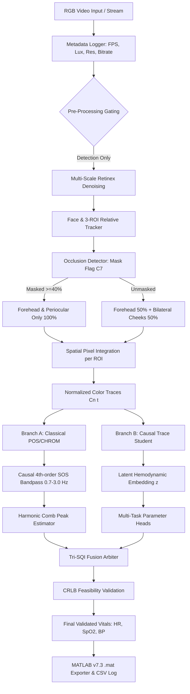

# FaceVitals: Architecture Specification
## Signal Flow, Component Topology & Dual-Path Processing

### 1. End-to-End System Topology

---

### 2. Physical Formulations & Principles

#### Plane-Orthogonal-to-Skin (POS)
For normalized RGB channels $\mathbf{C}_n(t) = \frac{\mathbf{C}(t)}{\mu_{\mathbf{C}}} - 1$:
$$S_1(t) = R_n(t) - G_n(t)$$
$$S_2(t) = R_n(t) + G_n(t) - 2 B_n(t)$$
$$\alpha(t) = \frac{\sigma(S_1)}{\sigma(S_2)}$$
$$\text{POS}(t) = S_1(t) + \alpha(t) S_2(t)$$

#### Harmonic Comb Maximum Likelihood Estimator
$$\hat{f}_{\text{pulse}} = \arg\max_{f \in [0.7, 3.0]\,\text{Hz}} \left[ P(f) + 0.5 \cdot P(2f) + 0.25 \cdot P(3f) \right]$$
Refined via parabolic interpolation over neighboring discrete Fourier bins:
$$f_{\text{refined}} = f_k + \frac{1}{2} \frac{\ln P_{k-1} - \ln P_{k+1}}{\ln P_{k-1} - 2\ln P_k + \ln P_{k+1}} \cdot \Delta f$$
$$\text{HR} = 60 \times f_{\text{refined}}\,\text{bpm}$$

#### Individual Typology Angle (ITA) in CIE $1976\,L^*a^*b^*$
$$\text{ITA} = \arctan\left(\frac{L^* - 50}{b^*}\right) \times \frac{180}{\pi}$$
Filtered for specular reflections ($L > 95$) and deep shadows ($L < 15$).
Binned into objective strata: ITA-1 ($>55^\circ$), ITA-2 ($41^\circ\text{--}55^\circ$), ITA-3 ($28^\circ\text{--}41^\circ$), ITA-4 ($10^\circ\text{--}28^\circ$), ITA-5 ($-30^\circ\text{--}10^\circ$), ITA-6 ($\le -30^\circ$).
